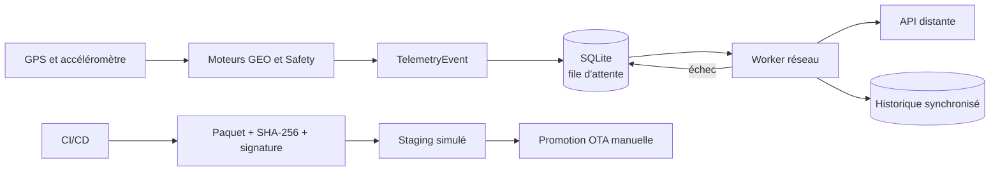

# GreenMove Edge — Industrialisation du POC télématique

GreenMove traite localement les positions GPS et les accélérations d'un camion. Le projet démontre une architecture **Edge** capable de poursuivre la collecte pendant une coupure réseau, de conserver les événements dans SQLite et de les synchroniser lorsque le service distant redevient disponible.

## Documentation

| Document | Contenu |
|---|---|
| [Architecture et résilience](docs/ARCHITECTURE_ET_RESILIENCE.md) | Flux de données, Store-and-Forward, backoff, circuit breaker et séparation collecte/réseau. |
| [Démonstration](docs/DEMONSTRATION.md) | Démonstration standard, mode stress, scénario de crise et résultats attendus. |
| [CI/CD et OTA](docs/CI_CD_ET_OTA.md) | Qualité, sécurité, build, SHA-256, signature, staging, promotion et rollback simulé. |
| [Stratégie et cahier de tests](docs/CAHIER_ET_STRATEGIE_DE_TESTS.md) | Organisation des 55 tests et comportements vérifiés. |
| [Historique des modifications](docs/HISTORIQUE_MODIFICATIONS.md) | Décisions de simplification, fonctionnalités conservées et résultats de validation. |

## Architecture générale



Le fonctionnement critique reste local : la collecte et la détection ne dépendent pas du réseau. SQLite conserve les événements avant leur envoi.

## Démarrage rapide

### Prérequis

- Python **3.10 ou plus récent** ;
- `pip` ;
- les dépendances de `requirements.txt` pour l'exécution et les tests.

### Windows — PowerShell

```powershell
cd "C:\chemin\vers\EdgeTelematics_industrialisation"
py -m pip install -r requirements.txt

py lancer.py demo
py lancer.py stress
py lancer.py resilience
py lancer.py tests
```

### Linux ou macOS — Terminal

```bash
cd /chemin/vers/EdgeTelematics_industrialisation
python3 -m pip install -r requirements.txt

python3 lancer.py demo
python3 lancer.py stress
python3 lancer.py resilience
python3 lancer.py tests
```

Le fichier `lancer.py` est le point d'entrée principal. Les fichiers `.bat` restent disponibles comme raccourcis Windows.

## Commandes disponibles

| Commande | Rôle |
|---|---|
| `py lancer.py demo` | Exécuter les moteurs GEO et Safety sur les données de l'exercice. |
| `py lancer.py stress` | Traiter 1 000 mesures d'accéléromètre simulées en flux. |
| `py lancer.py resilience` | Montrer la coupure réseau, les retries, le circuit breaker, le timeout et l'idempotence. |
| `py lancer.py tests` | Exécuter les 55 tests automatisés. |
| `py lancer.py build` | Construire le ZIP et son manifeste SHA-256. |
| `py lancer.py staging` | Exécuter le paquet construit et simuler rollback puis installation réussie. |
| `py lancer.py ota --mode rollout` | Simuler le déploiement progressif et le rollback N-1. |

Sous Linux ou macOS, remplacer `py` par `python3`.

## Résultats attendus de la démonstration standard

### GEO

```text
[GPS OUT] id=1 time=08:00:00
[GPS OUT] id=2 time=08:00:10
[GPS OUT] id=3 time=08:00:20
[ALERT ZFE] id=4 time=08:00:30 ...
[GPS IN] id=5 time=08:00:40
```

Le moteur utilise la Bounding Box comme premier filtre, puis le Ray Casting pour vérifier l'appartenance au polygone. Dans cette version industrialisée, il publie uniquement l'événement d'entrée dans le polygone.

### Safety

```text
[HARSH BRAKING] timestamp=1678880005 acc_y=-3.45 m/s²
[SAFETY SUMMARY] samples=10 harsh_braking_events=1
```

Le moteur lit les mesures une par une. Il utilise un seuil de détection à `-2,5 m/s²` et un seuil de réarmement à `-2,3 m/s²` pour ne pas compter plusieurs fois un même plateau de mesures fortes.

### Fichiers créés

| Fichier | Contenu |
|---|---|
| `daily_score.json` | Bilan Safety écrit de façon atomique. |
| `greenmove.db` | Alertes en attente et historique synchronisé. |
| `resultats_demo/` | Fichiers de la démonstration de résilience. |
| `dist/` | Paquet et manifeste créés par le build. |
| `staging/` | Rapport et fichiers de la démonstration de staging. |

## Par où commencer dans le code

Le projet contient des mécanismes industriels, mais leur lecture peut se faire progressivement :

| Ordre | Fichier | Ce qu’il montre |
|---:|---|---|
| 1 | `lancer.py` | Les commandes disponibles, sans entrer dans les algorithmes. |
| 2 | `run_demo.py` | L’enchaînement : détecter, enregistrer dans SQLite, puis synchroniser. |
| 3 | `src/geo/geo_engine.py` | La Bounding Box et le Ray Casting avec des boucles et des conditions simples. |
| 4 | `src/safety/safety_engine.py` | La lecture en flux, le seuil de freinage et le réarmement. |
| 5 | `src/storage/event_repository.py` | Le Store-and-Forward : écrire avant le réseau, relire, archiver. |
| 6 | `src/sync/circuit_breaker.py` puis `sync_service.py` | Les trois états du circuit et les nouvelles tentatives d’envoi. |
| 7 | `src/ota/` et `scripts/` | Le build, le contrôle du paquet, le rollback et le déploiement simulé. |

Les fichiers de `tests/` utilisent `pytest`, des threads et des simulations de panne. Ils servent à vérifier le projet ; ils ne constituent pas le meilleur point de départ pour comprendre les traitements.

Les mécanismes de résilience restent techniques, mais le code applicatif utilise désormais des fonctions, des boucles et des conditions explicites, sans `dataclass` ni annotations de types complexes.

## Structure du projet

```text
EdgeTelematics_industrialisation/
├── lancer.py
├── run_demo.py
├── run_bloc3_demo.py
├── src/
│   ├── domain/       # événements métier
│   ├── geo/          # Bounding Box et Ray Casting
│   ├── safety/       # lecture en flux et détection des freinages
│   ├── storage/      # SQLite Store-and-Forward
│   ├── sync/         # worker réseau et circuit breaker
│   └── ota/          # vérification et simulation de mise à jour
├── scripts/          # build, staging, clés et rollout OTA
├── tests/            # 55 tests automatisés
├── data/             # données de démonstration
├── docs/             # documentation détaillée
├── .github/workflows/
└── requirements*.txt
```

## Périmètre fonctionnel de cette version

Cette mise à jour améliore la structure, le lancement, la documentation et la robustesse des fichiers **sans modifier les règles métier existantes** :

- le moteur GEO détecte l'entrée dans le polygone ZFE ;
- le moteur Safety utilise l'hystérésis actuelle, sans anti-rebond temporel de 200 ms ;
- le mode stress traite 1 000 mesures ;
- SQLite, le backoff, le circuit breaker, l'idempotence et la chaîne OTA sont conservés.

Les évolutions fonctionnelles éventuelles doivent être traitées séparément afin de ne pas les confondre avec un refactoring de lisibilité.
