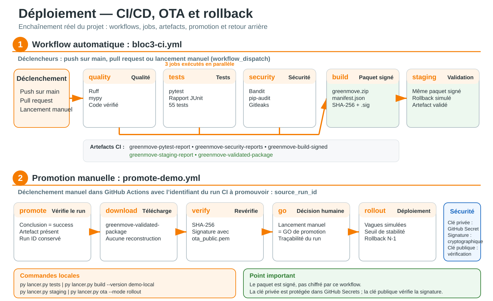

# CI/CD et OTA

## Schéma de l’enchaînement



### Jobs réellement présents

| Workflow | Job | Déclenchement ou dépendance | Résultat principal |
|---|---|---|---|
| `bloc3-ci.yml` | `quality` | Push, pull request ou lancement manuel | Contrôles Ruff et mypy |
| `bloc3-ci.yml` | `tests` | En parallèle de `quality` et `security` | Tests pytest et rapport JUnit |
| `bloc3-ci.yml` | `security` | En parallèle de `quality` et `tests` | Rapports Bandit, pip-audit et Gitleaks |
| `bloc3-ci.yml` | `build` | Après réussite des trois jobs précédents | `greenmove-build-signed` : ZIP, manifeste, SHA-256 et signature |
| `bloc3-ci.yml` | `staging` | Après `build` | `greenmove-staging-report` et `greenmove-validated-package` |
| `promote-demo.yml` | `promote` | Lancement manuel avec `source_run_id` | Promotion du même paquet validé, puis rollout simulé |

### Comment les lancer

**Depuis le poste :**

```powershell
py lancer.py tests
py lancer.py build --version demo-local
py lancer.py staging
py lancer.py ota --mode rollout
```

**Depuis GitHub Actions :**

1. Un push sur `main`, une pull request ou un lancement manuel déclenche **Bloc 3 CI**.
2. Après un run vert, copier l’identifiant numérique présent dans l’URL `/actions/runs/<ID>`.
3. Ouvrir **Promotion OTA - Demo**, cliquer sur **Run workflow** et saisir cet identifiant dans `source_run_id`.
4. Le job `promote` vérifie le run source, télécharge `greenmove-validated-package`, contrôle le SHA-256 et la signature, puis lance la simulation du rollout.

> **Signature et chiffrement :** la signature est cryptographique, mais le paquet n’est pas chiffré par cette chaîne. La clé privée est protégée dans GitHub Secrets ; la clé publique du dépôt vérifie que le paquet provient bien de la chaîne autorisée et qu’il n’a pas été modifié.

## Chaîne GitHub Actions

Le workflow `.github/workflows/bloc3-ci.yml` suit cet ordre :

```text
Ruff → mypy → pytest → Bandit → pip-audit → Gitleaks
     → build → SHA-256 → signature → staging
```

| Étape | Preuve produite |
|---|---|
| Qualité | Vérification Ruff et mypy. |
| Tests | Rapport JUnit pytest. |
| Sécurité | Rapports Bandit, pip-audit et Gitleaks. |
| Build | ZIP, manifeste et SHA-256. |
| Signature | Signature du ZIP avec la clé privée stockée dans GitHub Secrets. |
| Staging | Exécution du paquet, rollback simulé puis installation réussie. |
| Promotion | Réutilisation du même paquet validé, sans reconstruction. |

## Démonstration locale

```powershell
py lancer.py build --version demo-local
py lancer.py staging
```

Le staging attend :

```text
160 mesures
1 freinage
0 alerte en attente
1 alerte synchronisée
rollback observé
installation réussie avec le même checksum
```

## Promotion GitHub

1. Lancer ou attendre un run vert du workflow **Bloc 3 CI**.
2. Copier l'identifiant numérique du run GitHub Actions.
3. Ouvrir **Promotion OTA - Demo**.
4. Lancer manuellement le workflow avec `source_run_id`.
5. Le workflow vérifie le run source et télécharge `greenmove-validated-package`.
6. Le SHA-256 et la signature sont revérifiés avant le rollout simulé.

Le lancement manuel représente le Go humain de la démonstration.

## Clés de signature

Depuis la racine :

```powershell
py scripts/generate_demo_signing_keys.py
```

Le script crée :

- `ota_private.pem`, à conserver hors de Git ;
- `keys/ota_public.pem`, utilisée pour la vérification.

Le contenu de la clé privée doit être enregistré dans le secret GitHub `OTA_SIGNING_PRIVATE_KEY`.

## Deux mécanismes OTA distincts

Le projet conserve un ancien exemple dans `src/ota/manifest.json`. Sa `demo_signature` est déterministe et pédagogique.

La chaîne CI principale utilise une méthode différente :

- ZIP construit une seule fois ;
- SHA-256 ;
- signature asymétrique avec OpenSSL ;
- vérification avec `keys/ota_public.pem` ;
- promotion du même artefact.

L'ancien exemple ne doit pas être présenté comme une signature de production.

## Ce qui est réel et ce qui est simulé

**Réel :** contrôles de qualité, tests, build, hash, signature CI, vérification, exécution du ZIP extrait et réutilisation du même paquet.

**Simulé :** capteurs, API distante, installation Android, MDM, vagues de flotte et rollback sur une Zebra réelle.
